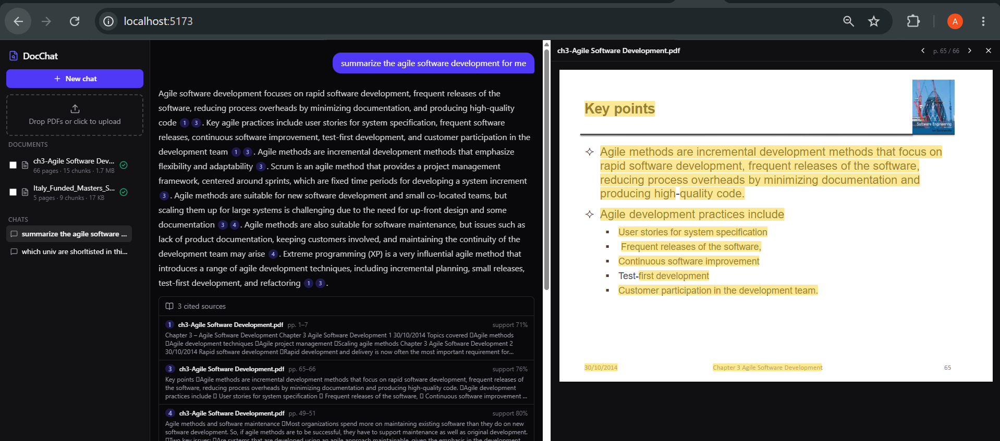

# DocChat

**Chat with your PDFs, fully local and free.** Upload documents and ask questions. You get answers with clickable citations that open the exact page with the source passage highlighted. When the answer isn't in your documents, DocChat says so instead of making something up.



Built from scratch, with no LangChain or LlamaIndex, so every stage of the RAG pipeline is visible and explainable.

## Features

- **Citations you can verify.** Every factual sentence ends with `[n]`. Click it to open the PDF at that page with the passage highlighted.
- **Honest "not found".** Two guards stop hallucinated answers: a similarity threshold before the LLM is called, and a `NOT_FOUND` sentinel the model can return.
- **Citation checking.** Each cited sentence is compared with its source chunk. Weakly supported claims are flagged as *low confidence*.
- **Hybrid search.** Dense vectors (bge-small) plus BM25 keyword search, merged with Reciprocal Rank Fusion. An optional cross-encoder reranker can be switched on.
- **Follow-up questions.** "What about the second one?" is rewritten into a standalone question using the chat history.
- **Streaming answers** over Server-Sent Events, with a Stop button.
- **Document filter.** You can limit questions to selected PDFs.
- **100% local and free.** Ollama runs the LLM, ONNX Runtime runs the embeddings, and ChromaDB and SQLite store everything on disk. No API keys and no PyTorch.
- **Evals.** hit@k and MRR compare dense, hybrid and hybrid+rerank retrieval. An LLM judge scores correctness and faithfulness.

## How it works

```
INGEST   PDF ─► text per page (PyMuPDF) ─► ~500-token chunks with overlap, page numbers kept
             ─► embeddings (bge-small, ONNX) ─► ChromaDB  +  BM25 keyword index

ASK      question ─► (follow-up? rewrite with chat history)
                  ─► dense top-20  +  BM25 top-20 ─► Reciprocal Rank Fusion ─► [rerank] ─► top 5
                  ─► best match too weak? ─► "I couldn't find that in your documents."
                  ─► LLM answers using numbered sources [1]..[5], streamed token by token
                  ─► citations parsed, validated and support-scored ─► shown in the UI
```

Only the top 5 chunks reach the LLM, so answering costs about the same with 1 PDF or 100. The heavy work (embedding) happens once, at upload.

## Tech stack

| Layer | Tools |
|---|---|
| LLM | [Ollama](https://ollama.com) (`qwen2.5:3b`, `llama3.1:8b`, …) |
| Embeddings / reranker | `BAAI/bge-small-en-v1.5`, `BAAI/bge-reranker-base` on ONNX Runtime |
| Retrieval | ChromaDB (HNSW), rank-bm25, Reciprocal Rank Fusion |
| Backend | Python, FastAPI, SSE streaming, SQLModel + SQLite, PyMuPDF, tiktoken |
| Frontend | React 19, TypeScript, Vite, Tailwind CSS v4, TanStack Query, react-pdf, react-markdown |
| Quality | pytest, custom eval harness with an LLM judge |

## Setup

### Requirements

- **Python 3.11+**
- **Node.js 20+**
- **Ollama** from https://ollama.com/download
- About 4 GB of free disk space (LLM ~2 GB, embedding model ~130 MB). 8 GB of RAM or more is recommended.

### 1. Get the code and a model

```bash
git clone https://github.com/Ammadkk/docchat.git
cd docchat
ollama pull qwen2.5:3b      # good on CPU-only laptops; use llama3.1:8b if you have a GPU
```

### 2. Backend

```bash
cd backend
python -m venv .venv
.venv\Scripts\activate           # macOS/Linux: source .venv/bin/activate
pip install -r requirements.txt
copy .env.example .env           # macOS/Linux: cp .env.example .env
```

Open `backend/.env` and set the model you pulled:

```
DOCCHAT_LLM_MODEL=qwen2.5:3b
```

Then start the API:

```bash
python -m uvicorn main:app --reload      # http://localhost:8000/docs
```

### 3. Frontend (second terminal)

```bash
cd frontend
npm install
npm run dev                              # http://localhost:5173
```

Open **http://localhost:5173**, drop in a PDF, wait for the green tick, and ask a question.

> The first upload and the first question are slower because the models are downloaded and loaded into memory.

### Production-style (one process)

```bash
cd frontend && npm run build
cd ../backend && python -m uvicorn main:app
```

FastAPI serves the built frontend at http://localhost:8000.

## Configuration

All settings are optional environment variables in `backend/.env` (see [`.env.example`](backend/.env.example)):

| Variable | Default | Purpose |
|---|---|---|
| `DOCCHAT_LLM_MODEL` | `llama3.1:8b` | Ollama model used for answers |
| `DOCCHAT_OLLAMA_HOST` | `http://localhost:11434` | Ollama server address |
| `DOCCHAT_USE_RERANKER` | `false` | Cross-encoder reranking (downloads ~1.1 GB on first use) |
| `DOCCHAT_TOP_K` | `5` | Chunks sent to the LLM |
| `DOCCHAT_CHUNK_TOKENS` | `500` | Chunk size in tokens |
| `DOCCHAT_MIN_SIMILARITY` | `0.45` | Below this, the app answers "not found" without calling the LLM |
| `DOCCHAT_MODEL_BACKEND` | `onnx` | `onnx` (no PyTorch) or `torch` (needs `pip install sentence-transformers`) |

## Testing and evals

```bash
cd backend
pytest                                   # unit tests (no LLM needed)

python cli.py ingest path/to/file.pdf    # try the pipeline from the terminal
python cli.py ask "What is the main conclusion?"

# Evals: copy evals/dataset.example.json to evals/dataset.json and write your questions
python -m evals.run_evals                # writes evals/results.md
python -m evals.run_evals --retrieval-only
```

## Troubleshooting

| Problem | Fix |
|---|---|
| `ollama` is not recognized right after installing | Your terminal still has the old PATH. Fully quit VS Code (File → Exit) or open a new terminal window. |
| Banner says *Model '…' not pulled* | Run `ollama pull <model>` and make sure `DOCCHAT_LLM_MODEL` in `backend/.env` matches. Restart the backend after editing `.env`. |
| `npm` fails in PowerShell with a security error | Use `npm.cmd run dev`, or run `Set-ExecutionPolicy -Scope CurrentUser RemoteSigned`. |
| Backend change doesn't take effect | Another copy of uvicorn may still be holding port 8000. Stop it with Ctrl+C in its terminal. |
| *An Application Control policy has blocked this file* (Windows) | Smart App Control blocks some unsigned DLLs. DocChat avoids PyTorch for this reason. For SQLAlchemy, install its pure-Python wheel (instructions in [`requirements.txt`](backend/requirements.txt)). |
| Answers are slow | On CPU-only machines, use a smaller model (`qwen2.5:3b`, `llama3.2:3b`). |

## Project structure

```
backend/
  main.py              FastAPI app, /api/health, serves the built frontend
  routers/             documents (upload, delete, serve file), chat (SSE), conversations
  ingest.py            PDF → chunks → embeddings → Chroma (runs in the background)
  docchat/             RAG core, no web framework:
    chunker.py, embeddings.py, onnx_models.py, vector_store.py, bm25_index.py,
    retriever.py, llm.py, prompts.py, citations.py, rag.py
  tests/, evals/
frontend/src/
  api/client.ts        typed API client and SSE parser
  hooks/               useDocuments (status polling), useChat (streaming)
  components/          Sidebar, ChatWindow, MessageBubble, CitationChip, SourcesAccordion, PdfPanel, …
```

## Roadmap

- [ ] Eval results on public PDFs (dataset of 30–50 questions)
- [ ] Tune the similarity threshold, chunk size and reranker
- [ ] Settings panel (model, top-k, reranker)
- [ ] OCR for scanned PDFs
- [ ] Docker Compose (backend + Ollama + frontend)

## License

[MIT](LICENSE)
